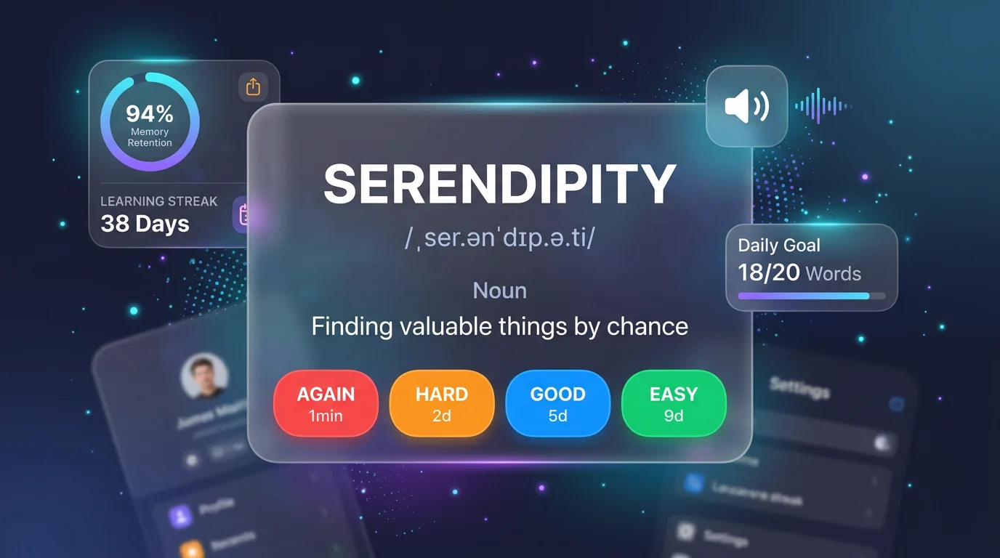
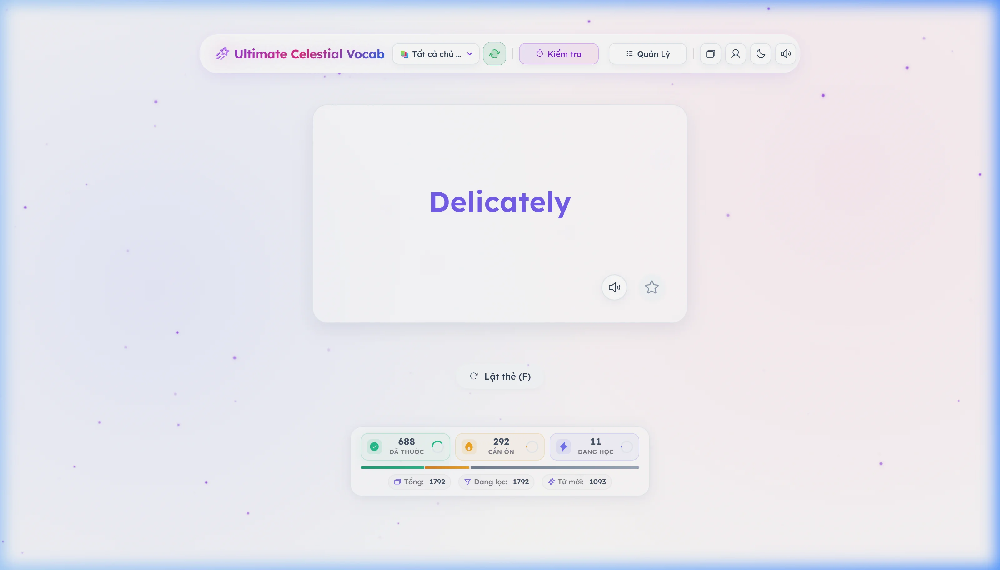
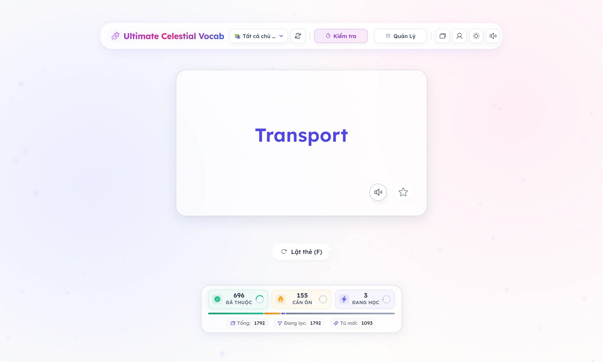
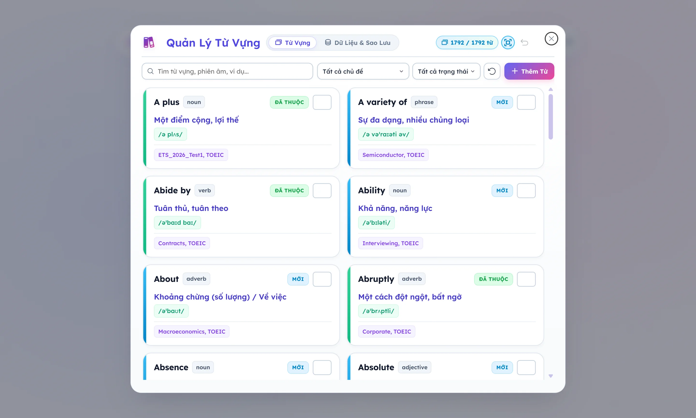
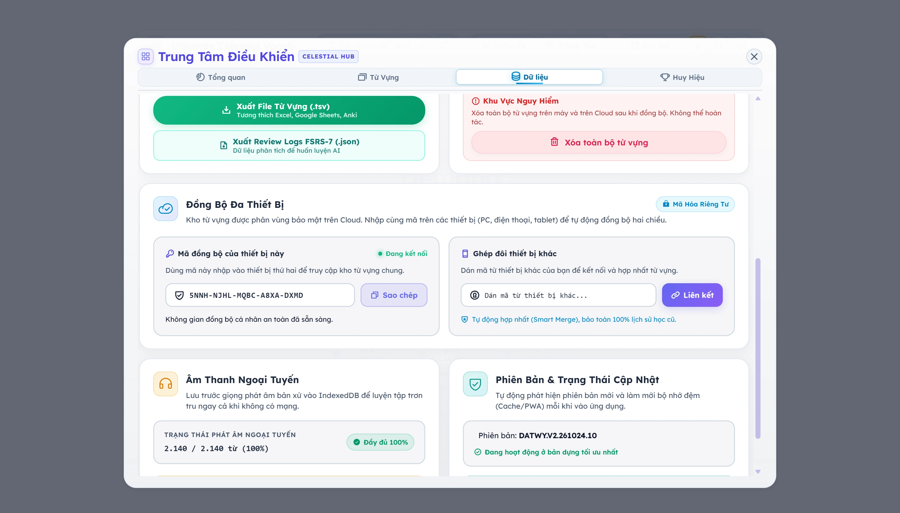
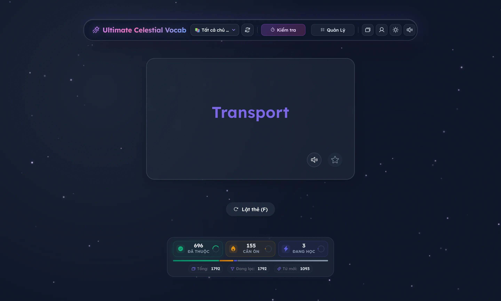
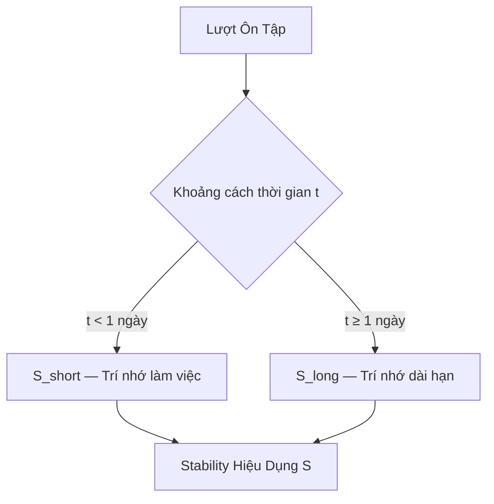
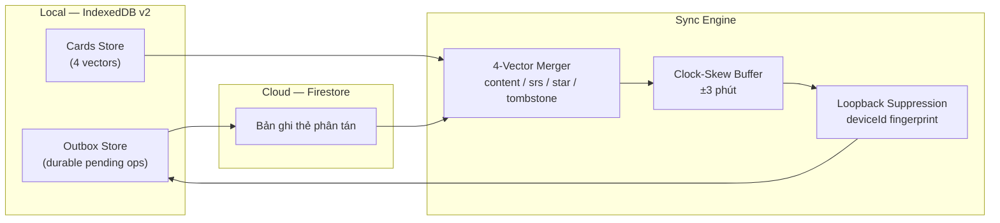

# Ultimate Celestial Vocab ✨

<div align="center">


-blueviolet.svg?style=for-the-badge)


<br/>

**Nền tảng học từ vựng tiếng Anh cá nhân hóa thế hệ mới — kết hợp thuật toán FSRS-7 (34 tham số), Heuristics ngôn ngữ học, đồng bộ đa thiết bị 4-Vector Outbox và hệ sinh thái Offline-First PWA.**

🌐 **[[hidden]](https://[hidden])** &nbsp;•&nbsp; [📖 Tài Liệu Kỹ Thuật](#8-kiến-trúc-hệ-thống--cấu-trúc-mã-nguồn) &nbsp;•&nbsp; [📊 Benchmark](#6-bằng-chứng--dữ-liệu-thực-nghiệm-benchmark)

<br/>



</div>

---

## 📑 Mục Lục
- [1. Giới Thiệu & Tầm Nhìn Sản Phẩm](#1-giới-thiệu--tầm-nhìn-sản-phẩm)
- [2. Tính Năng Nổi Bật](#2-tính-năng-nổi-bật)
  - [2.1. Không Gian Học Tập Zen Tối Giản](#21-không-gian-học-tập-zen-tối-giản)
  - [2.2. Trung Tâm Điều Khiển (Celestial Hub)](#22-trung-tâm-điều-khiển-celestial-hub)
  - [2.3. Hệ Thống Đồng Bộ 4-Vector Outbox](#23-hệ-thống-đồng-bộ-4-vector-outbox)
  - [2.4. Chế Độ Dark / Light Mode](#24-chế-độ-dark--light-mode)
- [3. Cơ Sở Khoa Học & Thuật Toán FSRS-7](#3-cơ-sở-khoa-học--thuật-toán-fsrs-7)
  - [3.1. Mô hình DSR (Difficulty - Stability - Retrievability)](#31-mô-hình-dsr)
  - [3.2. Kiến Trúc Trí Nhớ Kép (Dual-Track Stability)](#32-kiến-trúc-trí-nhớ-kép)
  - [3.3. Động Học Độ Khó & Mean Reversion](#33-động-học-độ-khó--mean-reversion)
  - [3.4. Ba Đột Phá Độc Quyền](#34-ba-đột-phá-độc-quyền)
- [4. Động Cơ Đồng Bộ 4-Vector Outbox](#4-động-cơ-đồng-bộ-4-vector-outbox)
- [5. Bộ Tối Ưu Hóa Ngoại Tuyến (Offline Optimizer)](#5-bộ-tối-ưu-hóa-ngoại-tuyến)
- [6. Bằng Chứng & Dữ Liệu Thực Nghiệm (Benchmark)](#6-bằng-chứng--dữ-liệu-thực-nghiệm-benchmark)
- [7. Hướng Dẫn Sử Dụng & Huấn Luyện 1-Click](#7-hướng-dẫn-sử-dụng--huấn-luyện-1-click)
- [8. Kiến Trúc Hệ Thống & Cấu Trúc Mã Nguồn](#8-kiến-trúc-hệ-thống--cấu-trúc-mã-nguồn)
- [9. Hướng Dẫn Cài Đặt & Phát Triển Cục Bộ](#9-hướng-dẫn-cài-đặt--phát-triển-cục-bộ)
- [10. Changelog](#10-changelog)
- [11. Giấy Phép & Tác Giả](#11-giấy-phép--tác-giả)

---

## 1. Giới Thiệu & Tầm Nhìn Sản Phẩm

Hầu hết các phần mềm học từ vựng truyền thống gặp phải các giới hạn cố hữu:
1. **"Ease Hell":** Bấm nhầm *Hard* một lần → Ease Factor bị trừ vĩnh viễn → thẻ lặp quá dày đặc.
2. **Đồng nhất hóa não bộ:** Giả định mọi bộ não đều quên với cùng tốc độ.
3. **Thiếu phân hóa phản xạ:** Không phân biệt lật thẻ thụ động vs. gõ chính xác chủ động.
4. **Xung đột đồng bộ đa thiết bị:** Last-Write-Wins xóa mất tiến độ SRS khi học cả PC lẫn điện thoại.

**Ultimate Celestial Vocab** giải quyết triệt để các rào cản này:

- **FSRS-7 Dual-Track:** Mô hình toán học chính xác nhất với 34 tham số sinh học cá nhân hóa.
- **Linguistic Heuristics v2:** Tính độ khó xuất phát điểm $D_0$ từ cấu trúc âm tiết, hình thái ngôn ngữ — giải quyết hoàn toàn Cold-Start Problem.
- **4-Vector Outbox Sync:** Tách riêng 4 vector (Content / SRS / Star / Tombstone) + IndexedDB Outbox → zero data loss khi offline rồi kết nối lại.
- **Zen Flashcard UX:** Giao diện tối giản, tập trung tuyệt đối vào từ vựng — không widget xao nhãng.

---

## 2. Tính Năng Nổi Bật

### 2.1. Không Gian Học Tập Zen Tối Giản

<div align="center">

| Mặt Trước (Active Recall) | Mặt Sau (4 Mức Đánh Giá SRS) |
| :---: | :---: |
|  |  |

</div>

- **Thẻ Flashcard trung tâm màn hình** — không dải sidebar, không widget mục tiêu xao nhãng.
- **Chế Độ Gõ Phím (Active Recall Typing):** Gõ đúng chính tả → Stability $\times 1.25$ (Active Motor Recall sâu hơn 25% so với lật thẻ).
- **Sóng âm động (Web Audio API):** Phát âm TTS chuẩn với animation waveform khi nghe.
- **Huy hiệu 🔥 Cực Khó:** Hiển thị tự động khi từ có độ khó cao hoặc từng bị quên nhiều lần.
- **Dock Thống Kê nhỏ gọn:** Chip "Đã thuộc / Cần ôn / Đang học" + thanh tiến độ phân màu ở cuối trang.
- **Phím tắt bàn phím:** `F` lật thẻ, `1/2/3/4` đánh giá SRS, `P` phát âm, `S` đánh sao, `Ctrl+Z` Undo.

---

### 2.2. Trung Tâm Điều Khiển (Celestial Hub)

<div align="center">

| Tab Tổng Quan & Trí Nhớ | Tab Từ Vựng |
| :---: | :---: |
|  |  |

</div>

4 tab được tổ chức gọn theo triết lý **"Mở ra là thấy ngay điều cần nhất"** (mặc định mở tab Tổng Quan):

| Tab | Nội Dung |
|---|---|
| 📊 **Tổng Quan & Trí Nhớ** | Bento Grid HUD: Level/XP, Streak, FusionSRS 3 chỉ số vàng, Forecast 7 ngày, Heatmap lịch 12×7 |
| 📚 **Từ Vựng** | Lưới thẻ từ vựng, tìm kiếm, lọc chủ đề/trạng thái, thêm/sửa/xóa, Radar Dedup |
| 💾 **Dữ Liệu** | Nhập TSV/JSON (hỗ trợ quotes đa dòng, BOM, header lộn xộn), Xuất Review Logs, cấu hình 34 tham số FSRS-7 + Optimizer on-device |
| 🏆 **Huy Hiệu** | Bộ sưu tập huy hiệu thành tựu mở khóa theo streak & độ khó |

**Heatmap nâng cấp:** 12 cột (12 tuần) × 7 hàng (Thứ 2 → CN) + nhãn Thứ/Tháng + thang màu ░▒▓█.  
**Topic display:** Dấu gạch dưới `_` tự động thay bằng dấu cách trong UI (dữ liệu gốc giữ nguyên).

---

### 2.3. Hệ Thống Đồng Bộ 4-Vector Outbox

Kiến trúc **Local-First / Offline-First** đảm bảo không bao giờ mất dữ liệu:

- **Outbox Store (IndexedDB v2):** Mọi thao tác viết được ghi vào Outbox trước → commit cục bộ an toàn → đồng bộ Firestore khi có mạng.
- **4 Vector độc lập:** Nếu PC sửa nghĩa từ và Mobile đang ôn tập cùng lúc → cả hai thao tác đều được bảo tồn.
- **Multi-tab safe:** 2 tab mở cùng lúc → merge bằng IndexedDB transaction, không ghi đè.
- **Chống Clock Skew:** Cửa sổ an toàn cho đồng hồ thiết bị lệch nhau.

---

### 2.4. Chế Độ Dark / Light Mode

<div align="center">



*Dark Mode: Nền Obsidian với ánh sáng huỳnh quang neon tím — tối ưu cho phiên học đêm. Light Mode: Porcelain Glass với tông Lavender/Slate tinh tế.*

</div>

---

## 3. Cơ Sở Khoa Học & Thuật Toán FSRS-7

### 3.1. Mô hình DSR

Trí nhớ được mô hình hóa bởi 3 biến trạng thái:
- **Độ khó ($D \in [1, 10]$):** Phức tạp vốn có của từ vựng đối với não bộ.
- **Độ bền ($S > 0$ ngày):** Thời gian để xác suất nhớ giảm từ $100\%$ xuống $90\%$.
- **Khả năng gợi nhớ ($R \in [0, 1]$):** Xác suất nhớ lại thành công tại thời điểm $t$.

Đường cong lãng quên (Power-Law Forgetting Curve):

$$R(t, S) = \left(1 + F \cdot \frac{t}{S}\right)^{-w_0}$$

Với $F = \frac{19}{81} \approx 0.2346$, $w_0 \approx 0.1443$. Khi $t = S$ thì $R = 90\%$ — đây là thời điểm tối ưu để ôn tập.

---

### 3.2. Kiến Trúc Trí Nhớ Kép



- **$S_{\text{short}}$:** Theo dõi working memory trong phiên học cấp tốc (cramming).
- **$S_{\text{long}}$:** Tăng trưởng theo công thức phi tuyến phụ thuộc $D$, $S$, $R$ và đánh giá người học:

$$S_{\text{new}} = S \cdot \left(e^{w_8} \cdot (11 - D) \cdot S^{-w_9} \cdot \left(e^{w_{10}(1-R)} - 1\right) \cdot \text{Multiplier}(\text{Grade}) + 1\right)$$

---

### 3.3. Động Học Độ Khó & Mean Reversion

$$\Delta D = -w_6 \cdot (\text{Grade} - 3)$$

$$D_{\text{next}} = w_5 \cdot D_0 + (1 - w_5) \cdot \text{clamp}(D + \Delta D,\ 1,\ 10)$$

Mean Reversion về $D_0$ ngăn thẻ bị kẹt vĩnh viễn ở trạng thái siêu khó.

---

### 3.4. Ba Đột Phá Độc Quyền

| Tính Năng | Cơ Chế | Lợi Ích |
|:---|:---|:---|
| **Linguistic Bias Parity** | $D_{\text{start}} = w_4 + \text{getDifficultyBias}(\text{word})$ | Giải quyết Cold-Start: từ đa âm tiết tự động nhận $D_0$ cao hơn |
| **Typing Modality Bonus** | $S_{\text{long}} \leftarrow S_{\text{long}} \times 1.25$ khi gõ đúng | Phản ánh Motor Recall sâu hơn 25% so với lật thẻ thụ động |
| **Chốt Chặn Graduation Floor** | $\text{Interval}_{\text{init}} \geq 1\ \text{ngày};\ \text{Interval}_{\text{init}} \leq 21\ \text{ngày}$ | Tránh từ bị cắt khỏi queue; tránh nhấn Easy làm thẻ biến mất 4 tháng |

---

## 4. Động Cơ Đồng Bộ 4-Vector Outbox



**Các trụ cột kỹ thuật:**
1. **Phân lập 4 Vector:** PC sửa nghĩa + Mobile ôn tập cùng lúc → cả hai đều được bảo toàn.
2. **Outbox bền vững (Durable Outbox):** Ghi nhận giao dịch chờ trong IndexedDB; retry tự động khi mạng phục hồi; pending ID không bao giờ bị xóa nhầm bởi response cũ.
3. **Multi-tab safe:** Mỗi write dùng IndexedDB transaction; 2 tab cùng mở không thể ghi đè nhau.
4. **Chống Clock Skew & Echo:** Cửa sổ 3 phút bù trừ đồng hồ lệch; `deviceId` fingerprint chặn loopback event của chính mình.

---

## 5. Bộ Tối Ưu Hóa Ngoại Tuyến

Nằm trong [`tools/train_fsrs7.js`](tools/train_fsrs7.js) — chạy hoàn toàn trên máy, không cần API:

- **Zero-Dependency:** Chỉ dùng Node.js built-in (`fs`, `path`, `os`).
- **On-device button:** Nút "Tối ưu trên máy" ngay trong modal Dữ Liệu — không cần mở terminal.
- **Holdout validation:** 80% train / 20% test theo thứ tự thời gian → chỉ áp dụng nếu test loss giảm đủ ngưỡng.

### Chiến Lược Tiến Hóa (1+λ)-ES

$$W_{\text{child}}^{(i)} = W_{\text{parent}} + \sigma \cdot \boldsymbol{\eta}_i, \quad \boldsymbol{\eta}_i \sim \text{Cauchy}(0, \mathbf{I})$$

$$\mathcal{L}(W) = -\frac{1}{N}\sum_{i=1}^N \left[Y_i\ln P_i + (1-Y_i)\ln(1-P_i)\right] + \lambda_{\text{reg}}\sum_{j=1}^{34}(W_j - W_{\text{base},j})^2$$

---

## 6. Bằng Chứng & Dữ Liệu Thực Nghiệm (Benchmark)

Kiểm định trực tiếp trên log học thực tế ($4{,}046$ lượt, $668$ thẻ, $73.5$ ngày):

```
================================================================================
                       KẾT QUẢ TỐI ƯU HOÁ FSRS-7
================================================================================
📉 Baseline Loss:          0.30443
🏆 Optimized Loss:         0.29050
📈 In-Sample Improvement:  +4.58%

--- Holdout (80% Train / 20% Future Test) ---
📊 Baseline Test Loss:     0.34333
🎯 Optimized Test Loss:    0.33450
🚀 Out-of-Sample:          +2.57% (không học vẹt)
```

### Bảng Hiệu Chuẩn Xác Suất Trí Nhớ

| Phân Nhóm | Số Lượt | $P$ Dự Đoán | Thực Tế Nhớ | Sai Lệch |
|:---|:---:|:---:|:---:|:---:|
| < 70% | 76 | 58.4% | 59.3% | -0.9% ✅ |
| 70–80% | 158 | 75.5% | 75.9% | -0.4% ✅ |
| 80–85% | 237 | 82.4% | 87.3% | -4.8% 🟡 |
| 85–90% | 610 | 87.7% | 87.2% | +0.5% ✅ |
| 90–95% | 1,157 | 92.9% | 93.2% | -0.4% ✅ |
| 95–100% | 1,146 | 97.3% | 96.4% | +0.9% ✅ |

> **RMSE hiệu chuẩn toàn dải: 2.07%** — mô phỏng đường cong quên sinh học với sai số trung bình chỉ 2%.

---

## 7. Hướng Dẫn Sử Dụng & Huấn Luyện 1-Click

```mermaid
sequenceDiagram
    autonumber
    actor User as Người Học
    participant Web as Celestial Vocab
    participant Opt as Optimizer (on-device)
    participant Cloud as Firebase

    User->>Web: Bấm "Xuất Review Logs (.json)"
    Web-->>User: celestial_review_logs_YYYY-MM-DD.json
    User->>Web: Mở Trung Tâm → Tab Dữ Liệu → "Tối ưu trên máy"
    Web->>Opt: Chạy (1+λ)-ES 100 thế hệ + holdout validation
    Opt-->>Web: 34 tham số mới (chỉ áp dụng nếu test loss giảm)
    Web->>Cloud: Đồng bộ cấu hình sang tất cả thiết bị
```

1. **Xuất log:** Trung Tâm Điều Khiển → Tab **Dữ Liệu** → **"Xuất Review Logs FSRS-7 (.json)"**.
2. **Tối ưu:** Bấm **"Tối ưu trên máy"** (hoặc kéo file vào `train_fsrs7.bat` trên Windows).
3. **Nạp:** Kết quả tự điền vào ô tham số → **"Lưu & Áp Dụng"** → đồng bộ tự động.

---

## 8. Kiến Trúc Hệ Thống & Cấu Trúc Mã Nguồn

**Tech Stack:** Vanilla JS ES Modules · Vite 5 · Pure CSS · IndexedDB (idb) · Firebase Firestore · Anime.js · HTML5 Canvas · Web Audio API · Phosphor Icons · Lexend Font · PWA/Workbox

```
ultimate-celestial-vocab/
├── index.html                      # SPA shell + tất cả modal
├── package.json                    # Vite + PWA plugin
├── vite.config.js
├── src/
│   ├── main.js                     # Entry point, khởi tạo app
│   ├── events.js                   # Toàn bộ event listeners
│   ├── core/
│   │   ├── state.js                # State management tập trung
│   │   ├── idb.js                  # IndexedDB v2 (outbox + cards + stats)
│   │   ├── firebase.js             # Firestore connection + Smart Sync
│   │   ├── sync.js                 # 4-Vector Merger Engine
│   │   ├── sync-status.js          # Trạng thái kết nối UI
│   │   ├── queue.js                # Review queue scheduler
│   │   ├── sound.js                # Web Audio API + TTS
│   │   ├── dedup.js                # Radar Semantic Dedup
│   │   ├── daily-stats.js          # Thống kê ngày / midnight rollover
│   │   ├── card-merge.js           # Merge logic 4-vector
│   │   ├── progress-merge.js       # XP / gamification merge
│   │   ├── review-log-merge.js     # Review history merge + Undo
│   │   ├── settings-merge.js       # FSRS params merge
│   │   ├── import-plan.js          # TSV import planner
│   │   ├── tabular.js              # TSV parser (quotes, BOM, reorder)
│   │   ├── animations.js           # Modal & UI animations
│   │   └── srs/
│   │       ├── index.js            # FSRS-7 main scheduler
│   │       ├── constants.js        # 34 params + validators
│   │       ├── training.js         # On-device optimizer
│   │       └── worker-manager.js   # Web Worker bridge
│   ├── features/
│   │   ├── gamification.js         # XP, level, streak
│   │   ├── badges.js               # Achievement system
│   │   ├── quiz.js                 # Quiz mode (XSS-safe)
│   │   ├── typing.js               # Active Typing Recall
│   │   ├── io.js                   # Import/Export
│   │   └── streakRecovery.js       # Streak freeze mechanic
│   ├── ui/
│   │   ├── render.js               # Thẻ từ, danh sách, biểu đồ, HUD
│   │   ├── modal.js                # Hub tabs, modal lifecycle
│   │   ├── elements.js             # DOM refs cache
│   │   ├── celestial-canvas.js     # Particle canvas (idle-aware)
│   │   └── waveform.js             # Audio waveform animation
│   └── css/
│       ├── style.css               # Design system chính
│       ├── transition.css          # Page transitions
│       └── study-polish.css        # Zen flashcard refinements
├── tests/                          # 52 unit/integration tests (Node.js built-in)
│   ├── import-and-srs.test.mjs
│   ├── progress.test.mjs
│   ├── reliability.test.mjs
│   └── storage.test.mjs
├── tools/
│   └── train_fsrs7.js              # (1+λ)-ES optimizer + TimeSeriesSplit
├── reports/
│   ├── strict-audit-2026-10-20/    # Audit report (GPT-6.1 independent review)
│   └── upgrade-2026-10-21/         # Upgrade report + test results
└── public/
    ├── version.json                # Build version (DATWY.V2.yymmdd.hh)
    └── manifest.webmanifest        # PWA manifest
```

---

## 9. Hướng Dẫn Cài Đặt & Phát Triển Cục Bộ

### Yêu cầu
- **Node.js** ≥ 18.0 (tested on v26.1.0)
- **Trình duyệt:** Chrome / Edge / Firefox / Safari mới nhất

### Bước cài đặt

```bash
# 1. Clone
git clone https://github.com/DATWY/ultimate-celestial-vocab.git
cd ultimate-celestial-vocab

# 2. Cài dependencies
npm install

# 3. Cấu hình Firebase
cp .env.example .env
# → Điền thông số Firebase project vào .env

# 4. Dev server
npm run dev
# → http://localhost:5173

# 5. Chạy 52 tests
npm test

# 6. Build production
npm run build

# 7. Deploy Firebase
firebase deploy --only hosting
```

### Chạy kiểm thử thuật toán riêng lẻ

```bash
# 179 kịch bản FSRS-7
node scratch/test_fsrs7_scenarios.js

# 5 kịch bản chống lặp từ
node scratch/test_anti_loop_unit.js
```

---

## 10. Changelog

### DATWY.V2.261021 (2026-10-21) — Data Integrity + UI Cleanup

**Core — Data Layer (audit độc lập GPT-6.1, 52/52 tests PASS):**
- ✅ IndexedDB v2 Outbox Store — durable offline writes, retry an toàn
- ✅ 4-Vector Firestore sync (content / srs / star / tombstone) với transaction
- ✅ Multi-tab safe — 2 tab mở cùng lúc không ghi đè nhau
- ✅ Midnight rollover fix — đổi ngày không bị reset sai
- ✅ Clock-skew resistant revisions — đồng hồ thiết bị lệch không làm hỏng thứ tự
- ✅ XSS-safe quiz feedback — escape tất cả HTML output
- ✅ TSV importer nâng cấp — quoted fields, BOM, reordered headers, enrichment
- ✅ On-device FSRS-7 optimizer — holdout validation, chỉ áp dụng khi test loss giảm
- ✅ Quiz idempotent finalization — không chấm điểm 2 lần, không race condition

**UI/UX:**
- ✅ Xóa study-session-bar "KHÔNG GIAN HỌC" — giao diện Zen thuần túy
- ✅ Heatmap 12×7 chuẩn lịch + weekday/month labels + legend ░▒▓█
- ✅ Topic names: `_` → space trong UI (dữ liệu gốc giữ nguyên)
- ✅ Rating buttons: cải thiện tương phản màu ở Light Mode
- ✅ Search box focus ring: clean glow ôm khít, không double border
- ✅ Autocomplete pollution fix — tắt browser history dropdown ô tìm kiếm
- ✅ Canvas idle-aware: tạm dừng RAF khi idle 3s / modal mở / tab ẩn nền
- ✅ Celestial Hub: mặc định mở tab Tổng Quan, loại bỏ tab "Who I Am"

### v4.3.0 và trước đó
- Giao diện Celestial Glassmorphism ban đầu
- FSRS-7 Dual-Track Stability
- Hệ thống Gamification (XP, Level, Streak, Badges)
- Quiz Mode, Active Typing Recall
- Radar Semantic Dedup

---

## 11. Giấy Phép & Tác Giả

Dự án được nghiên cứu và phát triển bởi **[DATWY](https://github.com/DATWY)**.  
Phát hành theo giấy phép **MIT License**.

<div align="center">

⭐ **Nếu dự án hữu ích, hãy tặng một Star trên GitHub!** ⭐

[🌐 Live App](https://[hidden]) &nbsp;•&nbsp; [🐛 Issues](https://github.com/DATWY/ultimate-celestial-vocab/issues) &nbsp;•&nbsp; [📦 Releases](https://github.com/DATWY/ultimate-celestial-vocab/releases)

</div>
