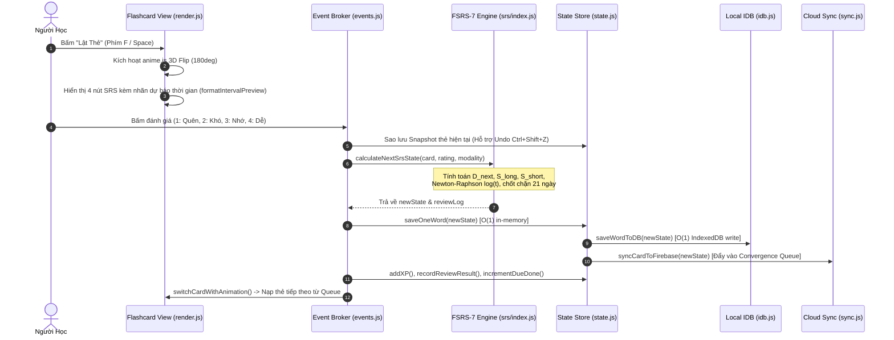

# 01 — KIẾN TRÚC KỸ THUẬT TOÀN DIỆN (TECHNICAL ARCHITECTURE)
**Dự án:** Ultimate Celestial Vocab ✨  
**Phiên bản:** v4.3.0  
**Tác giả hệ thống:** DATWY  
**Tài liệu tham chiếu:** [DESIGN_DOC.md](file:///C:/Users/ASUS/Desktop/CODING/test%20v3/ultimate-celestial-vocab%20-%20vipper%201/DESIGN_DOC.md), [README.md](file:///C:/Users/ASUS/Desktop/CODING/test%20v3/ultimate-celestial-vocab%20-%20vipper%201/README.md)  

---

## 1. Bản Đồ Công Nghệ (Technology Stack)

| Tầng Kiến Trúc | Công Nghệ Lựa Chọn | Phiên Bản | Vai Trò & Ghi Chú Kỹ Thuật |
|---|---|---|---|
| **Runtime & Tooling** | Node.js | v18.0.0+ (Tested v26.1.0) | Môi trường chạy script tối ưu hóa tham số offline và build tooling. |
| **Module Bundler** | Vite | ^5.0.0 | Biên dịch ES Modules, Hot Module Replacement (HMR), tree-shaking và tối ưu hóa static assets. |
| **Progressive Web App** | `vite-plugin-pwa` + `workbox-window` | ^1.3.0 / ^7.4.1 | Tạo Service Worker (`dist/sw.js`), precache 23 tài nguyên cốt lõi, runtime caching Google Fonts & CDNs, hỗ trợ cài đặt Add-to-HomeScreen (A2HS). |
| **Frontend Framework** | **Vanilla JavaScript (ESM)** | ES2022+ Native | Không dùng bất kỳ framework nào (Zero React, Zero Vue). DOM manipulation trực tiếp, cấu trúc module hướng sự kiện. |
| **Styling Engine** | **Pure Custom CSS** | CSS3 Modern | Biến CSS Custom Properties (`:root`, `body.dark`), Glassmorphism `backdrop-filter`, GPU-accelerated transforms. |
| **Animations** | Anime.js | ^3.2.1 | Hiệu ứng đếm số mượt mà (Odometer count-up), hiệu ứng lật thẻ 3D, mở/đóng modal. |
| **Local Database** | IndexedDB via `idb` | ^8.0.3 | Lưu trữ thẻ từ vựng và thiết lập hệ thống ngoại tuyến (Offline-First). |
| **Cloud Database** | Cloud Firestore | SDK v10.8.1 (ESM) | Đồng bộ dữ liệu phân tán hai chiều với `persistentLocalCache` và multi-tab sync. |
| **Cloud Storage** | Firebase Storage | SDK v10.8.1 (ESM) | Lưu trữ bản sao lưu và dữ liệu nhị phân nếu cần mở rộng. |
| **TTS & Proxy** | Google Apps Script + Web Speech API | Cloud Web App Exec | Proxy chuyển đổi Text-to-Speech thành tệp âm thanh dữ liệu lưu vào IndexedDB `audio-db-v2`. |
| **Procedural Audio** | Web Audio API | HTML5 Native | Bộ tổng hợp sóng âm Synthesizer tạo âm thanh hiệu ứng (lật thẻ, sao, hoàn tất) khi mất mạng. |
| **Multi-threading** | Web Workers API | HTML5 Native | Chạy thuật toán tối ưu hóa tham số CMA-ES trong background thread không block giao diện. |
| **Typography & Icons** | Lexend Font + Phosphor Icons | 300..700 / Webfont | Phông chữ thiết kế tối ưu cho đọc lướt khoa học và hệ biểu tượng Duotone/Fill phong phú. |

---

## 2. Sơ Đồ Kiến Trúc Tổng Thể (System Architecture Map)

```mermaid
graph TB
    subgraph "Client Layer (Browser / PWA Container)"
        User[Người Học - User]
        
        subgraph "UI & Presentation Layer"
            DOM[DOM Cache elements.js]
            Canvas[Celestial Canvas Particle Engine]
            AudioSys[Audio & TTS Subsystem sound.js]
            Router[DOM View Router & Modal Coordinator modal.js]
            EventBroker[Central Event Broker events.js]
        end
        
        subgraph "Domain Features Layer"
            StudyEngine[Flashcard Study View]
            TypingEngine[Active Typing Recall typing.js]
            QuizEngine[Challenge Quiz Engine quiz.js]
            DedupEngine[Radar Semantic Dedup dedup.js]
            GamifyEngine[Gamification & Badges gamification.js]
        end

        subgraph "Core Business & Mathematics Layer"
            StateStore[In-Memory Reactive State state.js]
            FSRS7[FSRS-7 Dual-Stability Engine srs/index.js]
            Heuristics[Linguistic Heuristics v2 srs/heuristics.js]
            QueueScheduler[Review Queue Scheduler queue.js]
            SyncMerger[4-Vector Disentangled Merger firebase.js]
            ConvergenceQueue[Cloud Push Convergence Queue sync.js]
        end

        subgraph "Local Persistence Layer"
            IDB[(IndexedDB: celestial-vocab-idb)]
            AudioCache[(IndexedDB: audio-db-v2)]
            LocalStorage[(localStorage: Fast Device Flags)]
        end

        subgraph "Background Compute Threads"
            Worker[Web Worker: CMA-ES Optimizer optimizer.worker.js]
        end
    end

    subgraph "External Cloud Infrastructure"
        Firestore[(Google Cloud Firestore: [hidden])]
        FirebaseHosting[Firebase Hosting CDN]
        GoogleTTS[Google Apps Script TTS Proxy]
    end

    %% Interactions
    User -->|Tương tác bàn phím, cảm ứng, gõ phím| EventBroker
    EventBroker --> Router
    EventBroker --> TypingEngine
    EventBroker --> StudyEngine
    EventBroker --> QuizEngine
    
    StudyEngine & TypingEngine & QuizEngine --> FSRS7
    FSRS7 --> Heuristics
    FSRS7 --> QueueScheduler
    
    StudyEngine & TypingEngine & QuizEngine --> StateStore
    GamifyEngine --> StateStore
    DedupEngine --> StateStore
    
    StateStore <-->|O(1) Incremental Write & Read| IDB
    AudioSys <-->|Object URL Cache & TTS Data| AudioCache
    
    StateStore -->|Enqueues Delta Changes| ConvergenceQueue
    ConvergenceQueue -->|Debounced 30s Batch / beforeunload| SyncMerger
    SyncMerger <-->|Bi-directional 4-Vector Sync| Firestore
    
    AudioSys -->|Fetch audio mp3| GoogleTTS
    StateStore -.->|Đẩy 400+ Review Logs| Worker
    Worker -.->|Trả về 34 tham số đã tối ưu| StateStore
```

---

## 3. Bản Đồ Cấu Trúc Mã Nguồn (Detailed Source Map)

```text
src/
├── core/                                # TẦNG NGHIỆP VỤ CỐT LÕI & LƯU TRỮ
│   ├── srs/                             # Hệ sinh thái thuật toán Spaced Repetition FSRS-7
│   │   ├── constants.js                 # 34 tham số mặc định chuẩn, các ngưỡng biên (S_MIN=0.1, S_MAX=36500, D_MIN=1, D_MAX=10)
│   │   ├── forgetting.js                # Hàm suy giảm trí nhớ Power-Law kép và bộ giải Newton-Raphson
│   │   ├── difficulty.js                # Động học độ khó (Delta D, hồi tụ trung bình Mean Reversion)
│   │   ├── stability.js                 # Động học độ bền trí nhớ S_long và S_short
│   │   ├── heuristics.js                # Bộ máy phân tích âm tiết, cụm từ, tần suất từ điển O(1)
│   │   ├── frequency-data.js            # Danh sách Set 500 từ vựng tiếng Anh phổ biến nhất
│   │   ├── index.js                     # Điều phối chính FSRS-7, chốt chặn 21 ngày, soft-migration
│   │   ├── worker-manager.js            # Trình quản lý vòng đời Web Worker
│   │   └── optimizer.worker.js          # Web Worker chạy thuật toán tiến hóa (1+lambda)-ES
│   ├── state.js                         # Global Store tập trung, Map index O(1), saveOneWord(), Undo stack
│   ├── idb.js                           # Lớp trừu tượng hóa IndexedDB (stores: vocabulary, settings)
│   ├── firebase.js                      # Kết nối Firestore, Server Time calibration, 4-Vector Merge Engine
│   ├── sync.js                          # Hàng đợi hội tụ (Convergence Queue), batch debounce 30s, auto-flush
│   ├── queue.js                         # Lập lịch hàng đợi ôn tập ưu tiên (Relearning -> Due -> New -> Later)
│   ├── sound.js                         # Engine phát âm thanh, TTS Apps Script Proxy, Web Audio Synthesizer
│   ├── animations.js                    # Trợ thủ hoạt ảnh Anime.js (lật thẻ, nhảy số odometer, mở popup)
│   ├── dedup.js                         # Radar Semantic Dedup v5.0 (Levenshtein, bỏ dấu tiếng Việt, gộp thẻ)
│   └── utils/
│       ├── date.js                      # Tiện ích xử lý múi giờ địa phương và chuỗi ngày YYYY-MM-DD
│       └── sanitize.js                  # Bộ lọc ký tự độc hại XSS (escapeHTML)
│
├── features/                            # CÁC TÍNH NĂNG NGHIỆP VỤ ĐỘC LẬP
│   ├── gamification.js                  # Hệ thống Cấp độ học giả, XP, Chuỗi ngày Streak, Heatmap 84 ngày
│   ├── badges.js                        # Hệ thống Huy hiệu Tu Luyện & Vũ Trụ (7 cấp phẩm, 100+ danh hiệu)
│   ├── typing.js                        # Chế độ Gõ phím Active Recall, bấm giờ phản xạ nợ-ron, gợi ý lũy tiến
│   ├── quiz.js                          # Chế độ Bài Kiểm Tra độc lập, bento HUD kết quả, danh sách từ sai
│   ├── streakRecovery.js                # Tự động phát hiện đứt chuỗi, cấp khiên bảo vệ và nhiệm vụ hồi phục
│   ├── fsrsPersona.js                   # Chẩn đoán tính cách trí nhớ người học dựa trên đường cong lãng quên
│   └── io.js                            # Xử lý kéo thả TSV/TXT, xem trước dữ liệu, xuất JSON Logs, nạp 34 params
│
├── ui/                                  # TẦNG TRÌNH DIỄN & GIAO DIỆN
│   ├── elements.js                      # Bộ nhớ đệm (DOM Tree Cache) ánh xạ tất cả phần tử trong index.html
│   ├── render.js                        # Hàm thao tác DOM (Flashcard, Thống kê, Segmented Bar, Bảng từ vựng)
│   ├── modal.js                         # Điều phối mở/đóng modal, hệ thống Toast notification, điều hướng Hub
│   ├── celestial-canvas.js              # Nền sao vũ trụ chuyển động, tự động ngủ tiết kiệm pin sau 3s không tương tác
│   └── waveform.js                      # Hoạt ảnh sóng âm 4 thanh biên độ khi phát âm từ vựng
│
├── css/                                 # CỤM STYLING PURE CSS
│   ├── style.css                        # Toàn bộ CSS giao diện ứng dụng (8,600+ dòng, Glassmorphism, Theme)
│   └── transition.css                   # Hoạt ảnh Rèm cửa Shipper Curtain Transition hoán đổi giao diện mượt mà
│
├── events.js                            # NÚT GIAO GẮN KẾT SỰ KIỆN TOÀN CỤC & PHÍM TẮT BÀN PHÍM
└── main.js                              # ĐIỂM KHỞI CHẠY (ENTRY POINT) ỨNG DỤNG & CHEAT ENGINE
```

---

## 4. Các Luồng Dữ Liệu Cốt Lõi (Core Data Flows)

### 4.1. Luồng Học & Đánh Giá Thẻ (Study & Review Feedback Loop)



### 4.2. Luồng Hòa Giải Đồng Bộ Đám Mây 4-Vector (Disentangled Sync Loop)

Khi đồng bộ với Cloud Firestore (`celestial_vocab_sync`), hệ thống phân rã bản ghi thành 4 vector độc lập nhằm bảo toàn tuyệt đối công sức người học:

1. **Tombstone Vector (`isDeleted`, `updatedAt`):** Nếu một bên xóa và thời điểm xóa mới hơn thời điểm cập nhật phía đối diện $\to$ Xóa thẻ. Nếu bên kia có sửa đổi nội dung mới hơn sau mốc xóa $\to$ Tự động phục hồi thẻ (Resurrect).
2. **SRS Memory Vector (`srsStatus`, `srsDueDate`, `srsInterval`, `stability`, `stabilityShort`, `difficulty`, `reps`, `lapses`, `lastReviewDate`):** Lấy toàn bộ vector từ thiết bị có lượt ôn tập gần nhất (`lastReviewDate` lớn hơn, hoặc `reps` cao hơn nếu hòa). Không bao giờ trộn lẫn giữa tham số $S$ của thiết bị A với $D$ của thiết bị B.
3. **Content Vector (`english`, `vietnamese`, `type`, `pronunciation`, `example`, `notes`):** Lấy từ thiết bị có sửa đổi nội dung gần nhất. Nếu nội dung tiếng Việt bên Cloud phong phú hơn $\to$ Chạy thuật toán `cleanAndDeduplicateVietnamese` để hợp nhất nghĩa.
4. **Tags & Star Vector (`tags`, `isStarred`):** Hợp nhất tập hợp (Set Union) toàn bộ nhãn chủ đề của cả hai thiết bị.

---

## 5. Tầng Dịch Vụ Phía Sau (Backend & External Infrastructure)

### 5.1. Google Cloud Firestore
- **Mã dự án:** `[hidden]` (cấu hình tại [.firebaserc](file:///C:/Users/ASUS/Desktop/CODING/test%20v3/ultimate-celestial-vocab%20-%20vipper%201/.firebaserc)).
- **Bộ sưu tập đồng bộ:**
  - `celestial_vocab_sync/{cardId}`: Lưu trữ từng thẻ từ vựng phân tán.
  - `celestial_user_sync/gamification`: Đồng bộ trạng thái Level, XP, Streak, Badges, Heatmap.
  - `celestial_user_sync/reviewLogs`: Lưu trữ lịch sử ôn tập nén dạng từ điển (`dict` và `logs`) phục vụ huấn luyện FSRS-7.
  - `celestial_user_sync/settings`: Lưu cấu hình 34 tham số người dùng (`userFsrs7Params`).
- **Cơ chế chịu lỗi:** Sử dụng `persistentLocalCache({ tabManager: persistentMultipleTabManager() })` cho phép ghi ngoại tuyến khi mất mạng và tự động đồng bộ đẩy lên khi có kết nối trở lại.

### 5.2. Google Apps Script TTS Proxy
- **Endpoint URL:** `https://script.google.com/macros/s/AKfycbx-PZ8pXIbPZXIOJqg0ggYAZ_KgkOvkZg9jkAJqL994ypOlr__G5hWxuOk00a8d0OY7/exec`
- **Cơ chế:** Nhận tham số văn bản tiếng Anh, gọi Google Translate TTS không bị chặn CORS, chuyển đổi dữ liệu thành âm thanh nhị phân nén, chuyển giao cho Client lưu trữ vĩnh viễn dưới dạng Object URL trong IndexedDB `audio-db-v2`.

---

## 6. Hệ Thống Lưu Trữ Cục Bộ (Local Storage Schema)

### 6.1. IndexedDB: `celestial-vocab-idb` (Version 1)
- **Object Store 1: `vocabulary`**
  - **KeyPath:** `id` (String UUID hoặc base36 timestamp random).
  - **Cấu trúc bản ghi thẻ từ vựng:**
    ```typescript
    interface VocabCard {
      id: string;                     // Mã định danh duy nhất
      english: string;                // Từ/cụm từ tiếng Anh
      vietnamese: string;             // Nghĩa tiếng Việt đã chuẩn hóa
      type?: string;                  // Loại từ: noun, verb, adj, idiom...
      pronunciation?: string;         // Phiên âm chuẩn IPA: /.../
      example?: string;               // Câu ví dụ ngữ cảnh
      tags: string[];                 // Mảng chủ đề: ["TOEIC", "Academic"]
      isStarred?: boolean;            // Đánh dấu sao yêu thích
      isSuspended?: boolean;          // Bị tạm ngưng do lapse >= 8 (Leech)
      isDeleted?: boolean;            // Đánh dấu xóa mềm (Soft delete)
      srsStatus: "New" | "Learning" | "Mastered"; // Trạng thái SRS
      srsDueDate: number | null;      // Timestamp mili-giây đến hạn ôn tập
      srsInterval: number;            // Khoảng cách giãn cách tính theo ngày
      difficulty: number;             // Độ khó D ∈ [1.0, 10.0]
      stability: number;              // Độ bền dài hạn S_long (ngày)
      stabilityShort?: number;        // Độ bền ngắn hạn S_short (ngày)
      reps: number;                   // Tổng số lần đã ôn tập thành công
      lapses: number;                 // Số lần quên (Rating 1)
      lastReviewDate?: number;        // Timestamp mili-giây lần ôn cuối
      updatedAt?: number;             // Timestamp cập nhật bản ghi
    }
    ```
- **Object Store 2: `settings`**
  - **Key-Value Store:** Lưu trữ các khóa:
    - `dailyStats`: Tiến độ học trong ngày, lịch sử retention 3 ngày gần nhất.
    - `gamification`: XP, Level, Streak, Heatmap 84 ngày, Unlocked Badges, chi tiết sự kiện tracking.
    - `reviewLogs`: Bản ghi nén mảng lịch sử ôn tập `{ dict: string[], logs: CompactLog[] }`.
    - `userFsrs7Params`: Mảng 34 số thực tham số cá nhân hóa của người học.
    - `userFsrs7TrainedAt`: Mốc thời gian huấn luyện mô hình FSRS-7 gần nhất.
    - `v3MigrationDone`: Cờ đánh dấu đã chuyển đổi schema từ phiên bản cũ.

---

## 7. Điều Hướng & Quản Lý Trạng Thái (Routing & State Management)

- **Cơ chế Routing:** Ứng dụng là một SPA đơn trang hoàn toàn, không nạp lại trang (Zero page reload).
- **Điều khiển màn hình:** 
  - Toàn bộ giao diện chính nằm trong `#main-flashcard-view`.
  - Màn hình kiểm tra nằm trong `#quiz-area` (hoán đổi thông qua việc thêm/gỡ class `.hidden`).
  - Hộp thoại Trung Tâm Điều Khiển `#manage-modal` chứa 4 tab độc lập (`overview`, `words`, `io`, `badges`), hoán đổi nội dung qua hàm `switchHubTab(activeTabId)` trong [modal.js](file:///C:/Users/ASUS/Desktop/CODING/test%20v3/ultimate-celestial-vocab%20-%20vipper%201/src/ui/modal.js).
  - Tích hợp điều hướng trực tiếp bằng tham số URL Query:
    - `?tab=overview` $\to$ Tự động mở Trung Tâm Điều Khiển ở Tab Tổng Quan.
    - `?tab=words` $\to$ Mở Tab Quản lý Từ vựng và tự động focus ô tìm kiếm.
    - `?theme=dark` / `?theme=light` $\to$ Ép buộc giao diện khởi động theo theme chỉ định.

---

## 8. Các Giới Hạn & Ràng Buộc Kiến Trúc Cần Tuân Thủ (Architectural Constraints)

1. **Không Thêm CSS Framework:** Nghiêm cấm đưa Tailwind CSS, UnoCSS hoặc CSS Reset vào dự án. Hệ thống đang sử dụng Pure CSS kế thừa biến toàn cục `:root`. Tailwind Preflight sẽ phá hủy toàn bộ tỷ lệ hiển thị hiện tại.
2. **Bảo Tồn Tính Tương Thích Ngược FSRS-7:** Dữ liệu thẻ hiện tại chứa cả hai quỹ đạo $S_{\text{long}}$ và $S_{\text{short}}$. Bất kỳ thao tác nâng cấp nào cũng phải duy trì sự hiện diện của các trường này, nếu không thuật toán sẽ rơi vào trạng thái Cold-Start giả.
3. **Cơ Chế Khử Trùng Lặp Nghĩa Tiếng Việt:** Khi người dùng nhập nghĩa hoặc đồng bộ Cloud, hàm `cleanAndDeduplicateVietnamese` trong [dedup.js](file:///C:/Users/ASUS/Desktop/CODING/test%20v3/ultimate-celestial-vocab%20-%20vipper%201/src/core/dedup.js) luôn chạy để tách dấu phẩy/chấm phẩy, xóa từ thừa, loại bỏ trùng lặp không phân biệt hoa thường. Không được bỏ qua bước này.
4. **Xử Lý DOM Cache elements.js:** Mọi truy xuất DOM đều phải thông qua đối tượng `DOM` trong [elements.js](file:///C:/Users/ASUS/Desktop/CODING/test%20v3/ultimate-celestial-vocab%20-%20vipper%201/src/ui/elements.js) để tránh gây nghẽn Layout Thrashing do `document.getElementById` lặp đi lặp lại trong vòng lặp hoạt ảnh.
